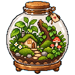

# Terrarium

Terrarium is a simple, extensible 3D engine.

This will be filled out when the project is further along.

## Docs

- [Cookbook](https://egakareta.github.io/terrarium/docs/)
- [API Reference](https://docs.rs/crate/terrarium/)
